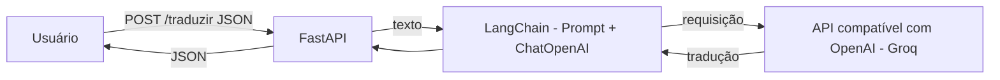

# Parte 2 - Questão 2: Tradutor inglês para francês com LangChain

API em FastAPI que usa o LangChain para traduzir textos do inglês para o francês, por meio da interface compatível com a OpenAI (`ChatOpenAI`).

## Observação importante sobre o provedor

O enunciado pede a integração com a API da OpenAI. Por falta de acesso à API paga da OpenAI, esta aplicação usa a classe `ChatOpenAI` do LangChain apontando para o **Groq**, que oferece uma API compatível com a da OpenAI. O modelo utilizado é `openai/gpt-oss-20b`. Para usar a OpenAI de fato, basta trocar `model`, `api_key` e remover o `base_url` no `main.py`.

## Como executar

1. Crie e ative um ambiente virtual:
   ```
   python -m venv .venv
   .venv\Scripts\Activate.ps1
   ```
2. Instale as dependências:
   ```
   pip install -r requirements.txt
   ```
3. Copie o arquivo `.env.example` para `.env` e coloque sua chave de API do Groq (https://console.groq.com/keys):
   ```
   GROQ_API_KEY=sua-chave-aqui
   ```
4. Rode a aplicação:
   ```
   uvicorn main:app --reload
   ```
5. Acesse http://127.0.0.1:8000/docs para testar.

## Exemplo de requisição

Rota `POST /traduzir` com o corpo:

```json
{"texto": "Hello, how are you today?"}
```

Resposta:

```json
{
  "original": "Hello, how are you today?",
  "traducao": "Bonjour, comment vas-tu aujourd'hui?"
}
```

## Arquitetura



Componentes principais:

- **FastAPI:** recebe o texto em JSON e devolve a tradução.
- **LangChain:** monta o prompt de tradução e gerencia a chamada ao modelo (cadeia `prompt | llm`).
- **API compatível com OpenAI (Groq):** executa o modelo e devolve o texto traduzido.

## Segurança

A chave de API fica apenas no arquivo `.env`, que está no `.gitignore` e não é enviado ao repositório.